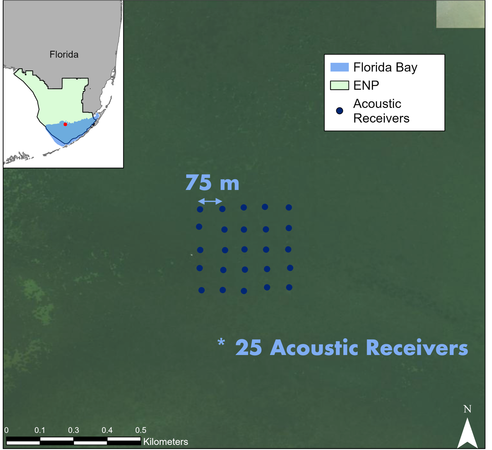

```{r setup, include=FALSE}
knitr::opts_chunk$set(collapse = T, cache = T)
```

## YAPS and Data filtering
This vignette uses the yaps package to calculate fish position and then goes over our process to filter the data. We then do some data mapping and exploration.

[R script](code/Code_Workshop_OTN_2026_YAPS_HMM_iSSF.R)

## Data
The data used for this example was collected by Rodemann, Costa et al. in Florida Bay. Acoustic telemetry data is from tagged spotted seatrout and environmental data is from field surveys done by Rodemann, Costa and team. 
  


## YAPS position calculations

This is the general workflow for syncing receivers and running tracks in YAPS. We won't be running this code in this workshop and in fact, this code does not work because the syncing fails. In reality, you need to play around with your sync data (including splitting up the time periods if there are "blackouts", possibly removing receivers, and other adjustments) for the sync model to be successful. We will pick up the workshop with the positions that were calculated by the developer of YAPS (WOW!), Henrik Baktoft.

:::{style="font-style: italic;"}
#load libraries\
#Install and load required libraries

install.packages(c('tidyverse', 'devtools', 'TMB'))\
library(devtools)\
library(tidyverse)\
library(TMB)\
devtools::install_github("baktoft/yaps")\
library(yaps)\
options(digits.secs = 3)

#test to make sure YAPS will work

testYaps()

#load data

vue <- data.table::fread('data/detections.csv', fill=TRUE)\
hydros <- data.table::fread('data/hydros.csv', fill=TRUE)\
detections <- prepDetections(raw_dat = vue, type='vemco_vue')\
detections <- detections %>% dplyr::filter(!is.na(frac))

#now we have our 2 datasets needed!

#sync hydrophones/
#set parameters

max_epo_diff <- 140 #Should be a little less than half of your shortest sync tag delay (ours are 6 - 10 minute)\
min_hydros <- 4 #minimum amount of hydrophones needed for each sync tag ping to be heard on. Start high, then go low\
time_keeper_idx <- 13 #Receiver with the "best clock"\
fixed_hydros_idx <- c(3, 7:8, 11, 13:17, 20:21) #Receivers that have the best known positions. The more, the better\
n_offset_day <- 2 #1 or 2\
n_ss_day <- 2 #number of times you want the model to calculate speed of sound a day. 2 is good, best to use water temp if you have it\
keep_rate <- 75 #number of sync tag detections for each hydro X offset_idx combinations to keep. Keeps the model doable

#compile list of dataframes

RYAPS <- list(hydros, detections)\
names(RYAPS) <- c('hydros', 'detections')\
RYAPS\$hydros\$sync_tag <- as.double(RYAPS\$hydros\$sync_tag)\
RYAPS\$detections\$tag <- as.integer(RYAPS\$detections\$tag)\
RYAPS\$detections\$epo <- as.integer(RYAPS\$detections\$epo)\
RYAPS\$detections\$serial <- as.integer(RYAPS\$detections\$serial)\

#compile data for syncing

inp_sync <- getInpSync(sync_dat = RYAPS, max_epo_diff, min_hydros, time_keeper_idx,
                       fixed_hydros_idx, n_offset_day, n_ss_day, keep_rate)

#check if it is good

getSyncCoverage(inp_sync, plot=T)


#we are good. Let's try syncing

sync_model <- getSyncModel(inp_sync, silent=TRUE)

#check quality of synchronization

plotSyncModelResids(sync_model, by='overall')\
plotSyncModelResids(sync_model, by='sync_tag')\
plotSyncModelResids(sync_model, by='hydro')\
plotSyncModelCheck(sync_model, by="sync_bin_sync")\
plotSyncModelCheck(sync_model, by="sync_bin_hydro")\
plotSyncModelCheck(sync_model, by="sync_tag")\
plotSyncModelCheck(sync_model, by="hydro")

#success! there is only a problem of 6 using SHYAPS1. I think it is fine. save it

save(sync_model, file = 'sync_model_4')

#apply sync model to detection data

detections_synced <- applySync(toa=RYAPS\$detections, hydros=RYAPS\$hydros, sync_model)

#Now that you have the sync model, run the tracks\
#use the estimated positions of hydros

hydros_yaps <- data.table::data.table(sync_model\$pl\$TRUE_H)\
colnames(hydros_yaps) <- c('hx','hy','hz')

#specify focal tag

focal_tag <- 34507\
rbi_min <- 20\
rbi_max <- 40

#extract relevant tag data from detections

synced_dat_34507 <- detections_synced[tag == focal_tag]


#compile TOA matrix

toa_YAPS_34507 <- getToaYaps(synced_dat_34507, hydros_yaps, rbi_min, rbi_max, pingType='rbi')

#compile all input data needed

inp_YAPS <- getInp(hydros_yaps, toa_YAPS_34507, E_dist="Mixture", n_ss=3, pingType="rbi",
                     sdInits=1, rbi_min=rbi_min, rbi_max=rbi_max, ss_data_what="est", ss_data=0)


inp_YAPS\$datTmb\$rbi_min\
inp_YAPS\$params\$top\
min(diff(inp_YAPS\$params\$top))\
checkInp(inp_YAPS)


#run YAPS!

yaps_out_34507 <- runYaps(inp_SAPS, silent=F)

plotYaps(yaps_out_34507)

:::
#This is where we will leave it for the YAPS run. We encourage all of you if you are interested to explore the package, as it can even run simulations! Now onto the data exploration and filtering

## Data filtering, exploration and graphing
In this section, we will look at the data, filter it based on the positional error from the YAPS algorithm, explore the data, and thengraph it as an abacus plot (yay!) as well as on a map. Then we will prep it for the HMM analysis.

```{r}
#Load in libraries
library(splitstackshape)
library(chron)
library(scales)
library(ggmap)
library(sf)
library(tidyverse)

data <- sfheadersdata <- read_csv('data/fish_positions.csv')
head(data)
```

The columns of this data include tag (last digits of tag number), x (longitude in UTM), y (latitude in UTM), x_sd (standard deviation (error) of longitude in meters), y_sd (standard deviation (error) of latitude in meters), z_sd (standard deviation (error) of depth in meters - not applicable), nobs (number of receivers detected on), and k (positions that represent a track)

## Decision on allowable error and abacus plot
The first big decision is determining how much error is acceptable within the positions calculated with the YAPS algorithm. This will play into the resolution of your environmental variables as well as how well you can interpret your results. In general, it is a trade-off between maximizing the amount of data while minimizing the amount of error. We are filtering it at a total error of 10 m, which will come into play with our environmental variables.

```{r}
#make a column with total error
data <- data %>%
  mutate(E = sqrt(x_sd^2 + y_sd^2))

#filter by error. We are going to filter out anything with an error greater than 10 m. This will have to match your environmental variables later
dat_10 <- data %>% filter(E < 10)

#summary stats
#number of positions per fish
dat_10 %>% group_by(tag) %>% summarize(n = n())

#abacus plot for positions
dat_10$ts <- as.POSIXct(dat_10$ts, format = '%Y-%m-%dT%H:%M:%OS')

# Break up the new datetime column into  a date, and a time
data <- dat_10

data$Date_Time2 <- data$ts

data <- cSplit(data, "Date_Time2", sep = " ", type.convert = F)

head(data)


# Rename columns so they make sense, it'll just be your last 2 column numbers, in this case the 15th and 16th column s
colnames(data)[12:14]<-c('E', "Date", "Time")
head(data)


# Then I repeat this and parse the date into year, month, and day (then hour, minute, second), so I can easily subset by year
# Copy date to parse out, maintain original date
data$Date2 <- data$Date


data<-cSplit(data, "Date2", sep = "-", type.convert = FALSE)
head(data)
colnames(data)[15:17]<-c("Year", "Month", "Day")
head(data)

data$Time2 <- data$Time

data <-cSplit(data, "Time2", sep = ":", type.convert = FALSE)
head(data)
colnames(data)[18:20]<-c("Hour", "Minute", "Second")
head(data)

# Assign classes so data plays nice for plotting and summaries
data$Date <- as.Date(data$Date)
data$Time <- as.times(data$Time)
data$Year <- as.numeric(data$Year)
data$Month <- as.numeric(data$Month)
data$Day <- as.numeric(data$Day)
data$Hour <- as.numeric(data$Hour)
data$Minute <- as.numeric(data$Minute)
data$Second <- as.numeric(data$Second)
data$tag <- as.factor(data$tag)


data$ts <- as.POSIXct(data$ts, format='%Y-%m-%d %H:%M:%S', tz='America/New_York')

head(data)

fish_det <- ggplot(data,aes(ts, tag)) + 
  geom_point() +
  scale_x_datetime(labels = date_format("%Y-%m-%d"),
                   date_breaks = "2 weeks", limits = as.POSIXct(c('2021-12-15 00:00:00', '2022-05-10 00:00:00')))+
  labs(x = "Date",  y = "Transmitter") +
  theme_bw()+
  theme(axis.text.x=element_text(angle= 50, size=10, vjust = 1, hjust=1),panel.grid.major = element_blank(), panel.grid.minor = element_blank()) +
  theme(axis.text.y=element_text(size=8))+
  labs(title = "Trout Detections YAPS")
fish_det
```

## Mapping!

```{r}
#We need to make the data into a spatial dataframe to graph onto a map
sfdat <- data %>% 
  st_as_sf(coords = c('x', 'y')) %>% 
  st_set_crs(2958) %>% 
  st_transform(4326) %>% 
  mutate(
    long = st_coordinates(.)[, 1],
    lat  = st_coordinates(.)[, 2])

#Fok, let's plot this in ggmap to get our bearings
# Note,a API key from Google Maps is required to load the map and run the below code. Visit https://rpubs.com/ktcross/1154003 for instructions on  how to install and run ggamps in R
# For now, we will use the already saved maps but the code to generate the maps if you have an existing API code is below as well.

# FLmap_zoom_out <- get_googlemap(center = c(lon=mean(sfdat$long), lat=mean(sfdat$lat)),
#                         zoom = 6,
#                         maptype = c("satellite"))

load("data/FLmap_zoom_out.RData")

ggmap(FLmap_zoom_out, extent='normal') + 
  geom_point(data = sfdat,
             aes(x = long, y = lat), col ="yellow") 

# FLmap_zoom_in <- get_googlemap(center = c(lon=mean(sfdat$long), lat=mean(sfdat$lat)),
#                                zoom = 16,
#                                maptype = c("satellite"))
load("data/FLmap_zoom_in.RData")

ggmap(FLmap_zoom_in, extent='normal') + 
  geom_point(data = sfdat,
             aes(x = long, y = lat,), col ="yellow") +
  facet_wrap(~tag)
```

## Calculating tracks
The most important part to set up for the HMMs is differentiating the tracks. This is where the second big decision comes in. How long do you wait between position before it is a new track? Depends on your array design, tag specifications, and the biology of your organism. We are using a cut-off of 5 minutes because our tags have an average burst interval of 20-40 seconds, meaning the fish would have to miss 10 detections (and therefore left the array).
```{r}
#So now we know where we are in space. Let's now set up the tracks for the HMM analysis
#We are going to filter it even more so that each position we keep is calculated by detections heard by 2 or more receivers
dat20 <- data %>% dplyr::filter(nobs >= 2)

#Now we are going to create a column that allows us to identify the start of a new track
#for this exercise, we decided that if the fish was not detected for 5 minutes, a new track would be created
dat20t <- dat20 %>% group_by(tag) %>% mutate(trackstart = ifelse(as.numeric(unclass(ts)-unclass(lag(ts))) > 300, 'Y', 'N')) %>% ungroup()
dat20t[is.na(dat20t)] <- 'Y'

str(dat20t)

#create a column that we can put track numbers in
dat20tt <- dat20t %>% group_by(tag) %>% mutate(track = ifelse(row_number() == 1, 1, NA)) %>% ungroup()

#create a function that numbers the tracks and inputs what track each row is in
tracknum1 <- function(x){
  for (i in 2:nrow(x)){
    if (x$trackstart[i] == 'Y'){
      x$track[i] <- x$track[i-1]+1
    } else {
      x$track[i] <- x$track[i-1]
    }
  }
  x
}

#apply across the data
dat_HMM <- dat20tt %>% group_by(tag) %>% group_modify(~tracknum1(.x)) %>% ungroup()
head(dat_HMM)
##Now we have the data we need for the HMMs!
```

We can now move to running the HMMs! See you in that module!
